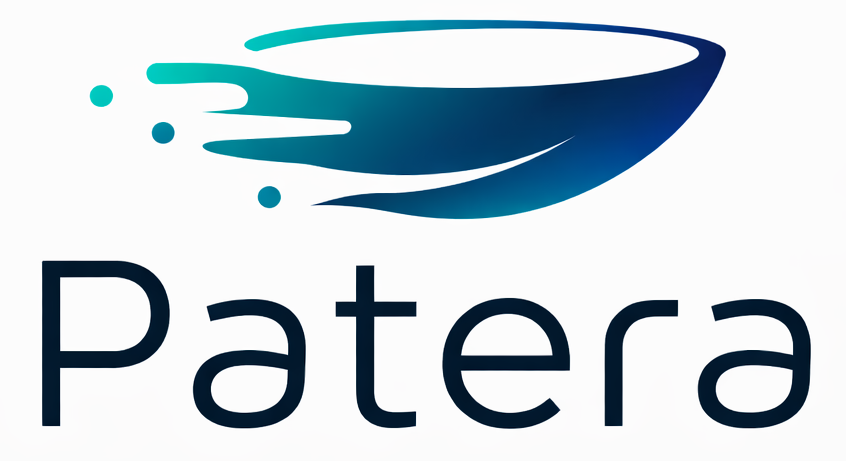

<p align="center">
  
</p>

# Patera

**Patera** is a modular, async-first [ASGI](https://asgi.readthedocs.io) web framework for Python
with a structure inspired by Java frameworks: class-based controllers, decorators for routing and
HTTP semantics, dependency injection of application services, and typed configuration objects.

```python
from pydantic import BaseModel

from patera import HttpStatus, MediaType, Request, Response
from patera.controller import Controller, consumes, get, path, post, produces

from app import App


class Greeting(BaseModel):
    name: str


@path("/api/v1/greetings")
class GreetingApi(Controller[App]):
    @get("/")
    async def hello(self, req: Request) -> Response:
        return req.res.json({"message": "Hello, World!"})

    @post("/")
    @consumes(MediaType.APPLICATION_JSON)
    @produces(MediaType.APPLICATION_JSON, HttpStatus.CREATED)
    async def greet(self, req: Request, greeting: Greeting) -> Response:
        return req.res.json({"message": f"Hello, {greeting.name}!"})
```

!!! warning "Beta"

    Patera is in beta. Until version 1.0, a minor release may contain breaking changes; each one
    is listed in the [changelog](project/changelog.md). The AI interface and the desktop packages
    are experimental.

## What is included

The **core package** (`patera`) handles:

- routing with class-based [controllers](guide/controllers.md) and Werkzeug converters,
- [requests and responses](guide/requests.md) with Pydantic validation and response shaping,
- [dependency injection](guide/dependency-injection.md) of singleton services,
- typed [configuration](guide/configuration.md) from classes and environment variables,
- [templates](guide/templates.md), [static files and static pages](guide/static-files.md),
- [CORS](guide/cors.md), [middleware](guide/middleware.md) and [exception handlers](guide/exception-handling.md),
- generated [OpenAPI](guide/openapi.md) documentation with Swagger UI,
- [logging](guide/logging.md) with Loguru and JSON Lines log files,
- a [command line interface](guide/cli.md) and a [test client](guide/testing.md).

Optional **[extension packages](extensions/index.md)** add SQL databases, migrations,
authentication, caching, scheduled tasks, e-mail, declarative API clients, JoltUI server
components, an admin dashboard, an AI interface and desktop applications.

## Where to start

<div class="grid cards" markdown>

-   :material-rocket-launch: **[Getting started](getting-started/index.md)**

    Install Patera and build your first application in a few minutes.

-   :material-book-open-variant: **[Guide](guide/index.md)**

    Every core feature explained with examples: controllers, services, middleware and more.

-   :material-puzzle: **[Extensions](extensions/index.md)**

    Databases, authentication, caching, task scheduling, admin and more.

-   :material-code-tags: **[Reference](reference/index.md)**

    Configuration options, CLI commands and the Python API.

</div>

## Requirements

- Python 3.13 or newer
- Any ASGI server; `patera dev` uses [Uvicorn](https://www.uvicorn.org) and `patera prod` uses
  [Granian](https://github.com/emmett-framework/granian)

## License

Patera and its extension packages are released under the [MIT License](project/license.md).
